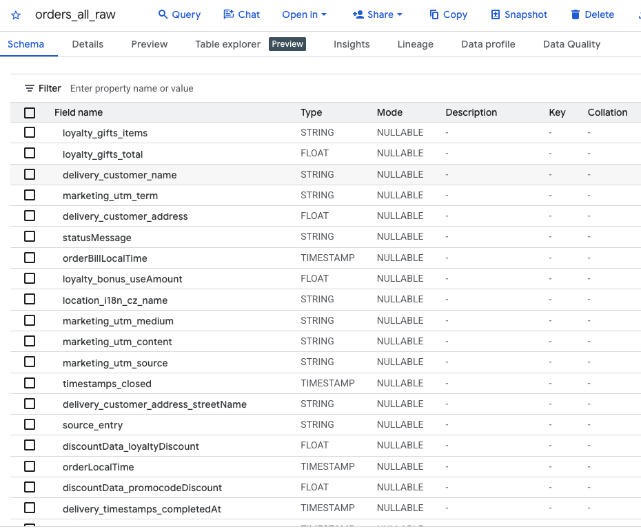
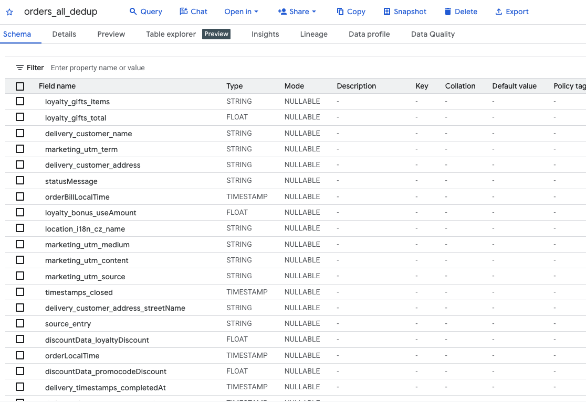
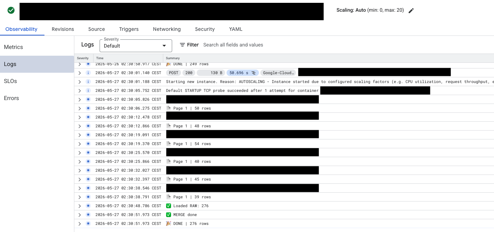

# ChoiceQR Orders Pipeline

Portfolio version of a restaurant orders ingestion pipeline built with Python, the ChoiceQR REST API, and Google BigQuery.

## Overview

The Python script retrieves archived orders for three configured restaurant locations, handles pagination and basic rate limits, normalizes the API responses, and appends records to a BigQuery raw table. Separate SQL examples demonstrate deduplication and reporting for business analytics.

> **Scope:** `main.py` implements API-to-BigQuery raw ingestion. The SQL scripts are not invoked automatically by the Python script. Deployment and scheduling configuration are not included in this portfolio repository.

## Technologies

Python · pandas · requests · SQL · Google BigQuery · Google Cloud Run (example screenshot)

## Architecture

```text
ChoiceQR REST API (3 locations)
             |
       Python / main.py
             |
     BigQuery raw orders
             |
  SQL transformations (separate)
             |
 Deduplicated and analytical data
```

## Setup

Requires Python 3.10+, an accessible ChoiceQR API account, a Google Cloud project and BigQuery permissions.

```bash
python -m pip install -r requirements.txt
```

Set the following environment variables (do not commit real tokens):

| Variable | Description |
| --- | --- |
| `PROJECT_ID` | Google Cloud project ID (required) |
| `DATASET` | BigQuery dataset, default `Data_total` |
| `TOKEN_VINOHRADY` | ChoiceQR token for Vinohrady |
| `TOKEN_ZIZKOV` | ChoiceQR token for Zizkov |
| `TOKEN_CHODOV` | ChoiceQR token for Chodov |
| `RAW_TABLE` | BigQuery raw table, default `orders_all_raw` |
| `MAX_PAGES`, `PER_PAGE`, `SLEEP_SECONDS` | Optional API pagination and pacing settings |

Authenticate to Google Cloud using Application Default Credentials, then run:

```bash
python main.py
```

The script loads a rolling two-day date range. It requires real API credentials and access to the target BigQuery dataset, so this repository is not directly runnable without configuration.

## Files

```text
main.py
config.example.py
requirements.txt
sql/
  daily_metrics.sql
  deduplicate_orders.sql
  first_time_customers.sql
  data_quality_checks.sql
screenshots/
  orders_all_raw.png
  orders_all_dedup.png
  cloud_run.png
```

## Analytics examples

- Daily orders, revenue and cancelled orders by restaurant
- First order date by customer phone number
- Deduplication with BigQuery `MERGE` on composite `(restaurant, _id)` keys
- Post-merge assertions for duplicate and null keys

**Important:** SQL scripts use `project_id` placeholders. The example `MERGE` assumes the raw table contains `_id`, `restaurant`, `status`, `orderLocalTime`, `total`, `timestamps_created`, and `loaded_at`, and the destination supports inserts into those five specified columns. It keeps the latest available version of each `(restaurant, _id)` pair according to `timestamps_created` and ingestion time. Verify actual schema, types, target constraints, and source identifier semantics before execution. The merge is not currently invoked by `main.py`.

Run `sql/data_quality_checks.sql` after the merge to assert there are no duplicate `(restaurant, _id)` keys or null identifiers in the target. This SQL is for BigQuery, and needs a configured dataset and credentials. Those assertions do not prove correct business values or full source-to-target completeness.

## Screenshots

**BigQuery raw orders**



**BigQuery deduplicated orders**



**Cloud Run deployment**



## Improvements planned

- Robust HTTP error handling and bounded 429 retries
- Validate source identifiers and target schema against a real BigQuery dataset
- Add additional data quality checks for freshness, reconciliation and business metrics
- Scheduling, orchestration, monitoring and CI/CD

## Author

Ruslan Panteleev
